# Architecture

Mermaid source: [`diagrams/architecture.mmd`](diagrams/architecture.mmd) ·
Rendered: [`architecture.svg`](diagrams/architecture.svg),
[`architecture.png`](diagrams/architecture.png)

The request path is
**React + Tailwind → Axios → Spring Security (JWT) → REST controllers → service
layer → Spring Data JPA → MySQL**, with the cooling-off scheduler entering the
service layer from the side rather than through a controller.

---

## Major components

### Browser

**React 18 + TypeScript + Vite + Tailwind.** Four role dashboards plus a shared
request-detail view. Route guards hide what a role cannot use, but they are a
usability measure only — every rule they reflect is enforced again on the
server.

**React Hook Form + Zod.** Client-side validation that mirrors the backend's
Bean Validation rules so a user sees a problem before a round trip. The backend
never trusts it.

**Axios client.** One instance with a bearer-token interceptor. A 401 clears the
stored token and returns the user to the login screen rather than leaving them
clicking into failures.

**Vite dev proxy.** `/api` → `http://localhost:9090`, so the UI never hardcodes
a backend origin and development needs no CORS preflight.

### Security

**`JwtAuthenticationFilter`** verifies signature, issuer and expiry, then
rebuilds the principal from the claims.

**`ActiveUserGuard`** re-checks the database on every request. A valid signature
is not enough: a soft-deleted user stops being able to act immediately rather
than when their token happens to expire.

**`SecurityConfig`** is stateless and role-based. Coarse URL rules live there;
the fine-grained rules that matter — only the assigned approver may decide, only
the recipient may read a notification — live in the service layer, where the
entity is in hand.

### REST controllers

Thin. They map HTTP to a DTO, apply `@PreAuthorize` for the coarse role check,
and delegate. No entity is ever exposed through a controller; no business rule
lives in one. Command DTOs reject server-controlled fields at deserialisation
time, so a request that tries to name its own approver fails outright instead of
half-succeeding.

### Service layer

Where the rules live, and the transaction boundary.

| Service | Responsibility |
|---|---|
| `BankChangeRequestService` | Creation: validate, generate a reference, derive the Maker from the token, place holds, assign the first approver — all in one transaction |
| `ApproverAssignmentService` | Deterministic, independent approver selection and reassignment |
| `ApprovalService` | The two stages, separation of duties, out-of-order and duplicate rejection |
| `BankActivationService` | Post-cooling-off revalidation and activation; supersedes rather than overwrites |
| `PaymentService` / `PaymentHoldService` | Payment lifecycle, hold placement, live eligibility, justified release |
| `EmergencyOverrideService` | The cooling-off exception, and nothing wider |
| `NotificationService` | Database-backed notifications, delivered inside the causing transaction |
| `AuditService` | Append-only audit events |
| `ReferenceGeneratorService` | Row-locked reference sequences |

### Cooling-off scheduler

`CoolingOffScheduler` runs on a cron expression and asks one question: which
requests are in `COOLING_OFF` with a deadline in the past? Each is handled in
its own transaction under a row lock, so a pass is idempotent and one failing
request cannot poison the batch.

Restart recovery is a property of this design rather than an extra mechanism.
The deadline lives in the database, so "the process was down when the window
closed" and "the process has just started" are the same situation: the next pass
finds the row and processes it.

### Persistence

Spring Data JPA over Hibernate, with pessimistic write locks on the rows where
two users can collide — approval tasks, bank-change requests, payments, and the
reference sequences — and `@Version` optimistic locking elsewhere.

Flyway owns the schema. `V1` creates it, `V2` adds the four roles and the
reference sequences, `V3` adds synthetic vendors and their banking records.
Users are never seeded by a migration, because a password hash does not belong
in version control.

### Database

MySQL 8, 14 tables. The constraints carry real weight here: unique indexes make
two active bank records per vendor, two open requests per vendor, two pending
tasks per stage, and two active holds per payment impossible at the storage
layer, not merely unlikely at the service layer.

---

## Why a modular monolith

Every capability in this system shares one transaction boundary at the moments
that matter. Creating a bank-change request places payment holds and assigns an
approver; if any part fails, none of it may stand. Across services that becomes
a distributed-transaction problem to solve. In one deployable it is a
`@Transactional` method.

The module boundaries are still real — each capability has its own package and
talks to its peers through services — so the seams exist if the system ever
outgrows one deployable. It has not.
