# Business workflow



Mermaid source: [`diagrams/business-workflow.mmd`](diagrams/business-workflow.mmd) ·
Rendered: [`business-workflow.svg`](diagrams/business-workflow.svg),
[`business-workflow.png`](diagrams/business-workflow.png)

Rectangles are manual actions. Stadium shapes are backend-automated steps.
Diamonds are decisions.

---

## The happy path, step by step

| # | Step | Who acts | What the backend does |
|---|---|---|---|
| 1 | Sign in | Maker | Issues a JWT carrying the user's roles |
| 2 | Select vendor | Maker | Serves only active, non-deleted vendors |
| 3-5 | Enter details and submit | Maker | — |
| 6 | Validate | — | Vendor active, no duplicate open request, details actually differ, no client-supplied server fields |
| 7 | Generate reference | — | `BCR-YYYY-NNNNNN` from a row-locked sequence |
| 8 | Derive identity | — | Maker taken from the JWT principal, never the body |
| 9 | Save | — | Request stored; live banking record untouched |
| 10 | Place holds | — | Every payable payment for that vendor is held |
| 11 | Assign first approver | — | Active APPROVER, never the Maker, fewest pending tasks, lowest id breaks ties |
| 12 | Notify | — | Notification written in the same transaction |
| 13 | First decision | Approver 1 | Rejection requires a meaningful comment |
| 15 | Assign second approver | — | Excludes the Maker and everyone already involved |
| 17 | Second decision | Approver 2 | The first approver can never be here |
| 19 | Start cooling-off | — | Deadline stored in the database |
| 20 | Watch the deadline | — | Scheduler, idempotent, restart-safe |
| 21 | Revalidate | — | Window elapsed, vendor active, both approvals present, two distinct approvers, neither is the Maker |
| 22-23 | Activate | — | New record activated; previous marked `SUPERSEDED`, never deleted |
| 24-26 | Payment eligibility and release | Accounts Payable | Separate, justified decision |
| 27 | Audit and notify | — | Throughout |

---

## The branches

**Rejection at either stage** terminates the normal workflow. Payment holds
survive it: whether the vendor's payments may resume is a separate Accounts
Payable decision, not a consequence of the approval outcome.

**Reassignment** (Accounts Payable or Administrator) closes the pending task as
`REASSIGNED` and opens a fresh one for an eligible replacement. The old task is
never deleted. The replacement must be active, hold the APPROVER role, not be
the Maker, and not have held any stage of this request.

**No eligible approver** stops the workflow where it stands. The request keeps
its status, nothing auto-approves, and no stage is skipped. Someone has to add
or reactivate an approver.

**Emergency override** (requested by Accounts Payable, decided by an
Administrator who is not the requester) brings the cooling-off deadline forward
to now:

```
COOLING_OFF (deadline in the future)
  --[override APPROVED]-->
COOLING_OFF (deadline = now, cooling_off_override_id set)
  --[scheduler revalidates, exactly as for any other request]-->
ACTIVATED | ACTIVATION_BLOCKED
```

The request does not jump to `ACTIVATED`. It becomes due, and the same
revalidation runs. Dual approval is a precondition the override cannot waive,
and payment holds are untouched.

**Failed revalidation** moves the request to `ACTIVATION_BLOCKED` and notifies
the Administrator and Accounts Payable. Later scheduler passes leave it blocked:
resolving an exception is a human decision, not a retry.

---

## What the UI cannot do

- Choose either approver, or reassign a task to itself
- Supply a maker id, request reference, payment reference or status
- Shorten or skip cooling-off
- Release a payment hold from any approval or override screen
- Edit a recorded approval decision or an audit row
